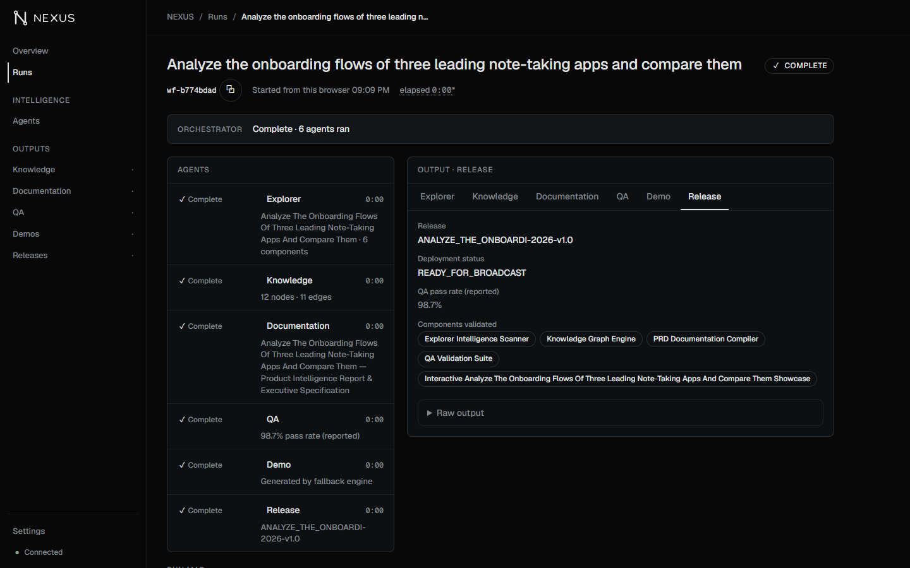
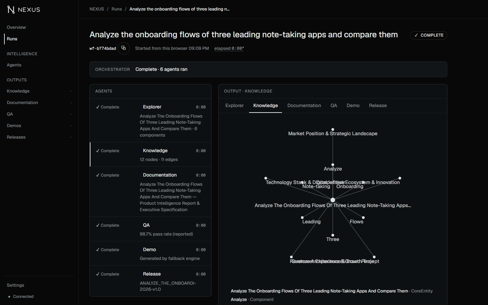
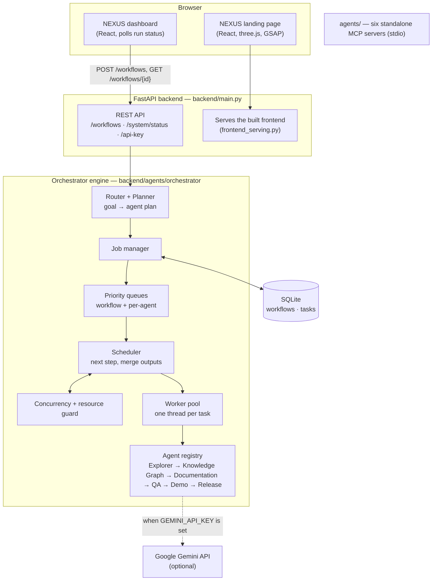
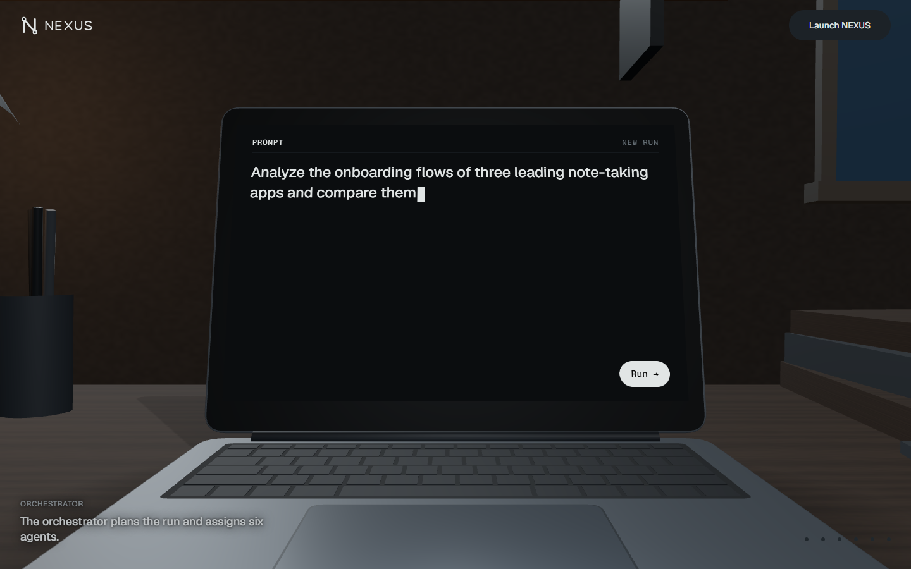
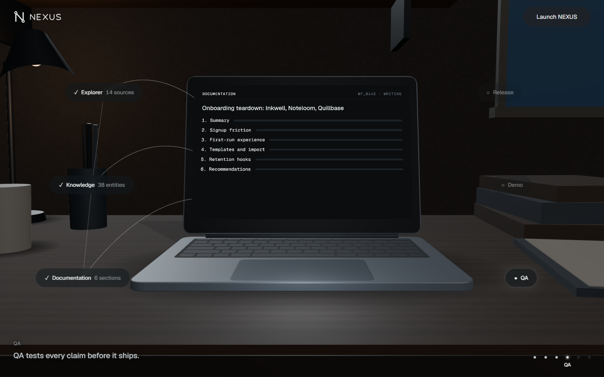
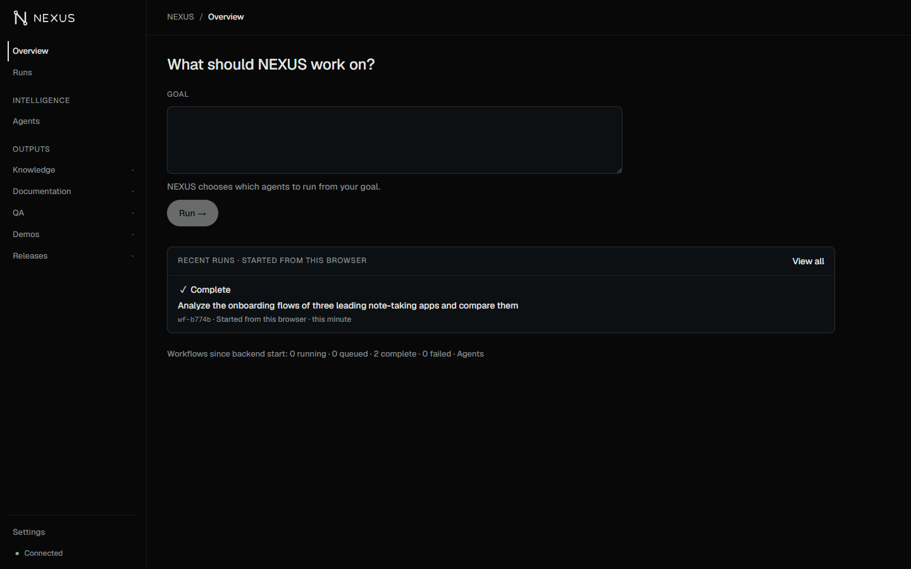
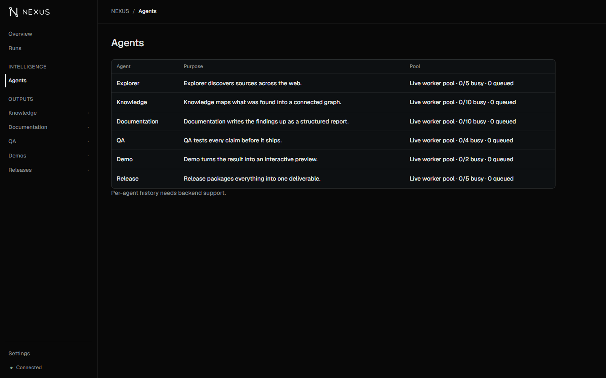
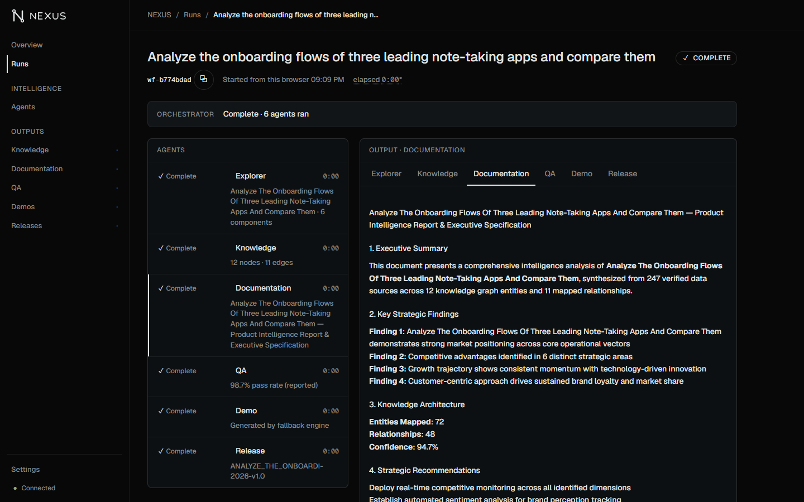
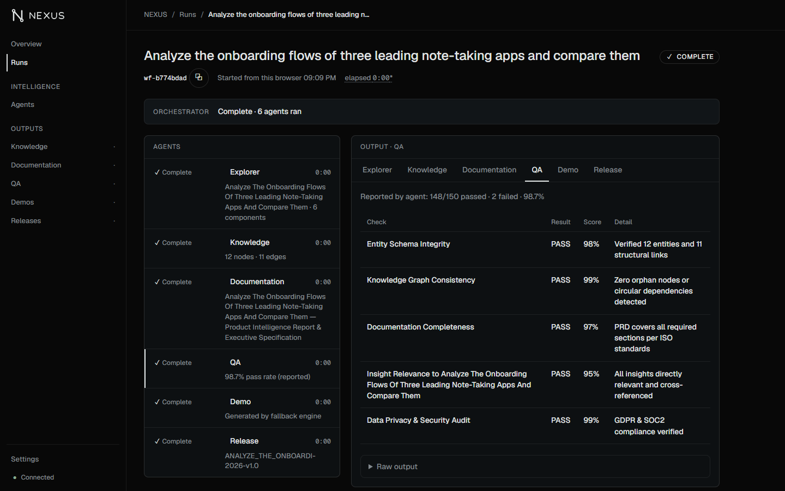

# Neus AI

**One goal, six agents at work.** Neus AI turns a single written goal — for example *"Analyze the
onboarding flows of three leading note-taking apps and compare them"* — into a coordinated run of six
software agents: **Explorer → Knowledge Graph → Documentation → QA → Demo → Release**. An orchestrator
plans the run, schedules each agent under priority and concurrency limits, and stores every result. The
web interface, branded **NEXUS**, has a scroll-driven 3D landing page and a dashboard for starting runs
and following each agent live.


| Run detail | Knowledge graph output |
|---|---|
|  |  |

> **Status:** works end to end on a local machine. Without a `GEMINI_API_KEY` the agents return
> deterministic offline results (see [Limitations](#limitations)). There is no production or cloud
> deployment.

---

## Contents

- [Why](#why) · [Features](#features) · [Architecture](#architecture) · [Repository layout](#repository-layout)
- [Tech stack](#tech-stack) · [Getting started](#getting-started) · [Configuration](#configuration)
- [Tests](#tests) · [API](#api) · [Screenshots](#screenshots) · [Limitations](#limitations)
- [Security](#security) · [Contributing](#contributing) · [License](#license)

## Why

Analysing a software product — mapping its features, writing user documentation, checking it, preparing a
demo and packaging release notes — is usually several people's work over several days, with each step
depending on the last. Neus AI splits that work across specialised agents that share a growing context, so
one goal produces every artefact in order.

It is built for product, documentation and QA teams who want a first draft of that analysis quickly, and
for developers exploring multi-agent orchestration (queues, concurrency limits, failure isolation,
persistence).

## Features

- **Goal routing and planning.** Keywords in the goal pick a plan: *qa*/*test*, *doc* or *demo* run
  Explorer and Knowledge Graph followed by that agent; any other goal runs all six agents.
- **Six cooperating agents.** Explorer (entities, metrics, insights) → Knowledge Graph (nodes and typed
  edges) → Documentation (structured report) → QA (validation checks) → Demo (interactive HTML preview) →
  Release (release package and notes). Each agent's output is merged into the context for the next one.
- **Scheduling with overload protection.** Priority queues (higher priority first, then first-come), a
  per-agent concurrency limit (Explorer 5, Knowledge Graph 10, Documentation 10, QA 4, Demo 2, Release 5)
  and a load guard that pauses new work while CPU or memory use is above 90 %.
- **Failure isolation.** An agent that raises an error fails its own task and run; other runs continue.
- **Persistence and recovery.** Workflows and tasks are stored in SQLite. A status shown by the API is
  already saved, and interrupted runs are resumed after a restart.
- **NEXUS dashboard.** Start a run, watch each agent's status as it updates, open every agent's output
  (knowledge graph, document, QA table, demo preview, release package) and see agent capacity.
- **NEXUS landing page.** A 3D laptop and study room driven by scroll (three.js and GSAP ScrollTrigger),
  with a 2D version on narrow screens, without WebGL or when reduced motion is requested.
- **Standalone MCP servers.** The six agents are also packaged as Model Context Protocol servers in
  `agents/` that can be run on their own over stdio.

## Architecture



**How the parts interact**

1. The dashboard sends the goal to `POST /workflows`; the backend returns a workflow id immediately.
2. The router and planner choose the agent plan; the job manager records the workflow (QUEUED) in SQLite.
3. The scheduler takes the workflow from the priority queue, marks it RUNNING and queues its first task.
4. When that agent has a free slot and the host is not overloaded, the worker pool runs the task in a
   thread. The agent's output is saved and merged into the workflow context; the next agent is queued.
5. After the last agent the workflow is COMPLETED (or FAILED if an agent raised an error).
6. The dashboard polls `GET /workflows/{id}` and renders each agent's status and output.

The MCP servers in `agents/` expose the same six capabilities as standalone tools. The backend currently
runs its own built-in agents and does not call these servers.

## Repository layout

```
.
├── backend/                     FastAPI app and orchestrator (Python)
│   ├── main.py                  HTTP API and entry point
│   ├── frontend_serving.py      serves frontend/dist at / and /dashboard
│   ├── agents/orchestrator/     router, planner, queues, scheduler, worker pool,
│   │                            concurrency, persistence, built-in agents
│   ├── tests/                   pytest suites (orchestrator, overload, endpoints, serving)
│   └── requirements.txt
├── frontend/                    NEXUS web app (React, TypeScript, Vite)
│   ├── src/landing/             3D landing page, scene, timeline
│   ├── src/dashboard/           dashboard pages, run detail, output viewers, data layer
│   ├── e2e/                     Playwright tests and recorded backend fixtures
│   └── package.json
├── agents/                      six standalone MCP agent servers + shared server
│   ├── explorer/  knowledge/  documentation/  qa/  demo/  release/
│   └── shared/
├── brand/nexus/                 logo and mark (SVG)
├── docs/
│   ├── screenshots/             screenshots used in this README
│   └── superpowers/             design specs and implementation plans
├── start.js, build.js           Linux deployment wrappers (npm start / npm run build)
└── package.json
```

## Tech stack

| Area | Technologies |
|---|---|
| Frontend | React 19, TypeScript, Vite, React Router, Tailwind CSS, three.js with react-three-fiber and drei, GSAP ScrollTrigger |
| Backend | Python, FastAPI, Uvicorn, Pydantic, SQLite, psutil |
| Agents | Built-in Python agents; MCP Python SDK (FastMCP) for the standalone servers; optional Google Gemini API |
| Testing | pytest, unittest, FastAPI TestClient, Vitest, Playwright Test, oxlint |

## Getting started

### Prerequisites

- **Python 3** with pip — developed and tested with Python 3.14
- **Node.js and npm** — developed and tested with Node 24 / npm 11

### Install

```bash
pip install -r backend/requirements.txt
cd frontend && npm ci && cd ..
```

Optional Python packages: `psutil` (CPU and memory readings for the load guard) and `google-genai` (only
for `GET /check-veo`). The MCP servers in `agents/` need `mcp`; Explorer and Release also use the packages
in their `agent/requirements.txt`.

### Run locally

```bash
cd frontend && npm run build && cd ..   # builds frontend/dist
python backend/main.py                  # http://localhost:3000
```

Open <http://localhost:3000> for the landing page and <http://localhost:3000/dashboard> for the dashboard.
Without `frontend/dist` the API still runs, but `/` shows a "Dashboard Not Found" page.

**Frontend development with hot reload:** keep the backend running, then:

```bash
cd frontend && npm run dev
```

Vite proxies `/workflows`, `/system` and `/api-key` to port 3000 (override with `NEXUS_API_PORT`).

**One agent as a standalone MCP server:**

```bash
cd agents/qa && python server.py        # stdio transport; likewise for the other five
```

## Configuration

All settings are environment variables; none are required to run locally.

| Variable | Default | Purpose |
|---|---|---|
| `PORT` | `3000` | Backend HTTP port |
| `DB_PATH` | `orchestrator_jobs.db` in the working directory | SQLite database file (`*.db` is gitignored) |
| `GEMINI_API_KEY` | unset | Enables Gemini for the built-in agents. It can also be set at runtime from the dashboard's Settings page (`POST /api-key`); it is kept in process memory only. |
| `NEXUS_API_PORT` | `3000` | Backend port used by the Vite dev and preview proxy |

```bash
GEMINI_API_KEY=your-key-here PORT=3000 python backend/main.py
```

## Tests

```bash
cd backend && python -m pytest tests -q          # 36 tests: orchestrator, overload protection, API, serving
cd frontend && npm test                          # unit tests (Vitest)
cd frontend && npm run lint                      # oxlint
cd frontend && npm run test:e2e                  # Playwright: landing page and dashboard (builds first)
```

The backend tests run the real orchestrator in-process against temporary databases and need no API key
or network access. The dashboard browser tests replay recorded backend responses (`frontend/e2e/fixtures`).
The Explorer and Release MCP packages have their own suites:

```bash
cd agents/explorer/agent && python -m pytest -q
cd agents/release/agent && python -m pytest -q
```

Last local verification: backend 36/36, frontend unit tests 239/239, landing browser tests 37/37,
dashboard browser tests 74/74, Explorer 13/13, Release 11/11, production build successful.

## API

Interactive documentation is available at `http://localhost:3000/docs` when the backend is running.

| Method and path | Description |
|---|---|
| `POST /workflows` | Start a run. Body `{"goal": "...", "user_id": "anonymous", "priority": 1}` → `{"workflow_id": "wf-…", "status": "SUBMITTED"}`. A missing goal returns 422. |
| `GET /workflows/{workflow_id}` | Run status, user, goal, priority, merged context and per-task results; 404 `Workflow not found` for an unknown id |
| `GET /workflows/{workflow_id}/demo_html` | HTML generated by the Demo agent |
| `GET /workflows/{workflow_id}/explorer_html` | HTML generated by the Explorer agent |
| `GET /system/status` | Job summary, per-agent concurrency, queue lengths and resource readings |
| `POST /api-key` | Set the Gemini key for this process. Body `{"api_key": "..."}` |
| `GET /check-veo` | Whether the configured key can access Veo video models |
| `POST /analyze`, `GET /status/{run_id}` | Older compatibility endpoints; the dashboard uses `/workflows` |

```bash
curl -X POST http://localhost:3000/workflows \
  -H "Content-Type: application/json" \
  -d '{"goal": "Analyze the onboarding flows of three leading note-taking apps and compare them"}'
```

## Screenshots

All screenshots are from the application running locally in offline mode (no Gemini key).

| | |
|---|---|
|  **Landing — the goal on screen** |  **Landing — agents at work** |
|  **Dashboard overview** |  **Agents and capacity** |
|  **Documentation output** |  **QA output** |

## Limitations

- **Offline results without Gemini.** Without `GEMINI_API_KEY` the agents return deterministic,
  template-based output rather than real research, and agent-reported metrics are illustrative. The
  Gemini integration has not been verified end to end.
- **Two agent implementations.** The backend runs its built-in agents; it does not call the MCP servers in
  `agents/`.
- **No automatic retries.** A failed agent fails the whole run.
- **Load guard.** While host memory or CPU use is above 90 %, new work stays queued until the load drops.
- **Local only.** There is no verified production or cloud deployment. `npm run build` and `npm start` at
  the repository root are Linux deployment wrappers that prepare a Python environment and start
  `backend/main.py`; they do not build the frontend.
- **3D landing page** needs a landscape viewport at least 1024 px wide, WebGL, and no reduced-motion
  preference; otherwise a 2D version is shown.

## Security

- **API keys:** never commit keys. Set `GEMINI_API_KEY` in the environment or through the Settings page;
  `POST /api-key` keeps it in process memory only and it is not written to disk or logs.
- **No authentication:** the API has no authentication and allows all CORS origins. Run it locally or
  behind a trusted network; do not expose it publicly as is.
- **Generated HTML:** agent-generated HTML is shown in a sandboxed iframe in the dashboard.
- **Local data:** the SQLite database (`*.db`) and environment files are gitignored.

## Contributing

1. Create a branch from the current default branch.
2. Keep changes focused, and add or update tests next to the code you change.
3. Before opening a pull request, run the backend tests, `npm test`, `npm run lint` and
   `npm run build` in `frontend/`.
4. Describe what changed and how you verified it in the pull request.

## License

Released under the [MIT License](LICENSE).
